# FiPA 들려드림 — 한국어촌어항공단 홈페이지 자동 연계형 AI 음성안내 서비스

> **디지털 취약계층과 고령자(70대 이상)를 위한 공단 홍보 콘텐츠 자동 수집·쉬운 AI 해설·음성 안내 웹앱**  
> **홍보 담당자가 별도로 콘텐츠를 개별 업로드하지 않아도 공단 공식 홈페이지의 최신 소식이 자동으로 수집·변환·안내됩니다.**

---

## 🌟 주요 특징

1. **홍보 담당자의 추가 업로드 제로 (완전 자동 연계)**
   - 한국어촌어항공단 공식 홈페이지의 4대 핵심 게시판(보도자료, 카드뉴스, 공지사항, 공고/공모)을 주기적으로 감지하여 신규 게시물을 자동 등록합니다.
2. **고령자 맞춤형 쉬운 설명 & 자연스러운 음성안내 (TTS)**
   - 행정 전문용어와 복잡한 공고를 어르신 눈높이에 맞춘 쉬운 한국어(존댓말)로 자동 재구성합니다.
   - 브라우저 표준 Web Speech API를 활용하여 별도 유료 음성 API 없이도 큰 소리로 차근차근 읽어드립니다.
3. **카드뉴스 멀티 이미지 슬라이더 및 통합 내러티브 구성**
   - 여러 장으로 구성된 카드뉴스를 순서대로 수집하여 고화질 슬라이드로 제공하며, 전체 카드뉴스의 흐름을 한 편의 자연스러운 음성 안내로 전달합니다.
4. **안전·정책 중요 정보 자동 분류 및 검수 정책**
   - 법정 의무교육(수산공익직불제 등), 지원금·보조금, 신청 자격, 안전/생명 지침, 중요 마감일은 시스템이 자동으로 감지하여 **‘검수 필요(PENDING_REVIEW)’**로 분류합니다.
   - 일반 보도자료는 자동 검증 후 **‘자동 발행(AUTO_PUBLISHED)’**되어 즉시 대국민 공개됩니다.
5. **어르신 전용 접근성 인터페이스**
   - 글자 크기 3단계 조절 (보통 / 크게 / 아주 크게)
   - 음성 속도 조절 (느리게 0.8x / 보통 1.0x)
   - 고대비 모드 (노란색/검정색 고대비 테마)
   - 스마트폰 원터치 접속용 QR코드 생성 기능
   - 음성(마이크 STT) 및 텍스트 대화형 질의응답 (Q&A)
6. **API 키 없는 상태에서도 100% 안전하게 동작하는 스마트 데모 모드**
   - OpenAI API 키가 없어도 실제 크롤링 데이터, 브라우저 TTS, 규칙 기반 고품질 쉬운 설명 및 Q&A 기능이 완벽하게 작동합니다.

---

## 🏗 시스템 아키텍처

```mermaid
flowchart TD
    subgraph FIPA["한국어촌어항공단 공식 홈페이지 (fipa.or.kr)"]
        B1["보도자료 (i-171)"]
        B2["카드뉴스 (i-170)"]
        B3["공지사항 (i-167)"]
        B4["공고/공모 (i-326)"]
    end

    subgraph Collector["자동 수집 & 검증 엔진"]
        direction TB
        Scraper["서버 측 HTML 스크래퍼 (Cheerio)"]
        SSRF["SSRF 보안 차단 & Rate Limiter"]
        Hash["SHA-256 컨텐츠 변경 감지"]
        Dedupe["게시판ID + ntt_sn 중복 방지"]
    end

    subgraph AI["AI 변환 및 정책 분류 파이프라인"]
        Rule["데모 규칙 엔진 (핵심 일정/연락처 보존)"]
        GPT["OpenAI GPT-4o-mini (프롬프트 인젝션 방지)"]
        PolicyFilter{"법정의무 / 안전 / 보조금 감지"}
    end

    subgraph DB["SQLite + Prisma ORM"]
        PostDB[("게시물 테이블 (Post)")]
        SyncDB[("동기화 이력 (SyncLog)")]
        ConfigDB[("시스템 설정 (SystemSetting)")]
    end

    subgraph UI["사용자 & 관리자 서비스"]
        SeniorApp["고령자 맞춤 웹앱 (Web Speech API TTS)"]
        AdminDashboard["통합 관리자 대시보드 (/admin)"]
        QnAService["음성/텍스트 AI Q&A (/api/ai/ask)"]
    end

    B1 & B2 & B3 & B4 --> Scraper
    Scraper --> SSRF --> Hash --> Dedupe
    Dedupe --> AI
    Rule & GPT --> PolicyFilter
    PolicyFilter -- "일반 소식" --> PostDB
    PolicyFilter -- "주요 정책" --> PostDB
    PostDB & SyncDB & ConfigDB --> SeniorApp & AdminDashboard & QnAService
```



---

## 🚀 빠른 시작 가이드

### 1. 환경 설정

`.env.example`을 복사하여 `.env`를 생성합니다. (초기 상태 그대로도 데모 모드로 즉시 동작합니다)

```bash
# .env 설정 예시
OPENAI_API_KEY=               # OpenAI API 키 (미입력 시 스마트 규칙 기반 데모 모드)
OPENAI_MODEL=gpt-4o-mini      # 사용할 OpenAI 모델
DEMO_MODE=true                # 데모 모드 플래그
SYNC_INTERVAL_MINUTES=60      # 자동 동기화 주기 (기본 60분)
DATABASE_URL="file:./dev.db"  # SQLite 로컬 DB 경로
```

### 2. 데이터베이스 초기화 및 최신 소식 수집

```bash
# Prisma Client 생성 및 DB 스키마 반영
npm run db:push

# 공단 홈페이지 4개 게시판 실시간 수집 및 AI 변환 실행
npm run sync
```

### 3. 서비스 실행

```bash
# Next.js 개발 서버 실행 (포트 3000)
npm run dev

# 또는 프로덕션 빌드 후 실행
npm run build
npm start
```

브라우저 접속 주소:
- **고령자 사용자 화면**: [http://localhost:3000](http://localhost:3000)
- **통합 관리자 대시보드**: [http://localhost:3000/admin](http://localhost:3000/admin)

### 4. 백그라운드 자동 스케줄러 데몬 실행 (배포 환경)

```bash
node scripts/scheduler-daemon.mjs
```
*관리자 화면에서 동기화 주기를 변경하거나 자동 수집을 토글하면, 서버 재시작 없이 30초 이내에 실시간으로 반영됩니다.*

---

## 📋 핵심 검증 및 테스트 결과

| 검증 항목 | 테스트 결과 | 세부 설명 |
|---|---|---|
| **게시판 목록 수집** | ✅ 정상 작동 | 보도자료(10건), 카드뉴스(12건), 공지사항(13건), 공고공모(10건) 탐색 성공 |
| **상세 URL 추출** | ✅ 정상 작동 | `./detail.do?ntt_sn=XXXX` 파싱 및 절대 경로 정규화 |
| **제목 및 등록일 추출** | ✅ 정상 작동 | `.view_tit strong` 및 `등록일 : YYYY.MM.DD` 정확 추출 |
| **보도자료 본문 추출** | ✅ 정상 작동 | 메뉴, 푸터, 스크립트, 공유버튼 완전 제거 및 순수 텍스트 정제 |
| **카드뉴스 이미지 추출** | ✅ 정상 작동 | `/editorimgfile.do?dn=...` 6장 순서대로 순차 추출 |
| **첨부파일 분석** | ✅ 정상 작동 | `.hwp` 등 미지원 형식은 '첨부파일 분석 미지원' 표기 |
| **게시물 중복 방지** | ✅ 정상 작동 | 2차 동기화 시 중복 0건 (Idempotency) 확인 |
| **정책/안전 자동 분류** | ✅ 정상 작동 | 수산공익직불제 의무교육 보도자료가 `PENDING_REVIEW`로 정확히 분류됨 |
| **관리자 대시보드** | ✅ 정상 작동 | 실시간 동기화, 주기 변경, 승인/비공개, AI 재분석 확인 |
| **Web Speech TTS 재생** | ✅ 정상 작동 | 고령자 맞춤 배속(0.8x~1.0x) 및 음성 대본 브라우저 재생 확인 |

---

## 🏛 운영기관 이용조건 및 법적 유의사항 (공식 연계 안내)

1. **robots.txt 분석 결과**:
   - `https://www.fipa.or.kr/robots.txt` 분석 결과, 크롤러에 대해 `Disallow: /fipa/bbs/`가 명시되어 있습니다.
2. **공식 인터페이스 추상화 (`ContentProvider`)**:
   - 현재 MVP는 공개 HTML을 정중한 트래픽(요청당 400~500ms 지연)으로 수집하도록 구현되어 있습니다.
   - 코드베이스 내에 `ContentProvider` 인터페이스가 추상화되어 있어, 공단 홍보/전산 부서로부터 **공식 OpenAPI 또는 내부 연계 API를 발급받는 즉시 한 줄의 교체로 전환**할 수 있습니다.
